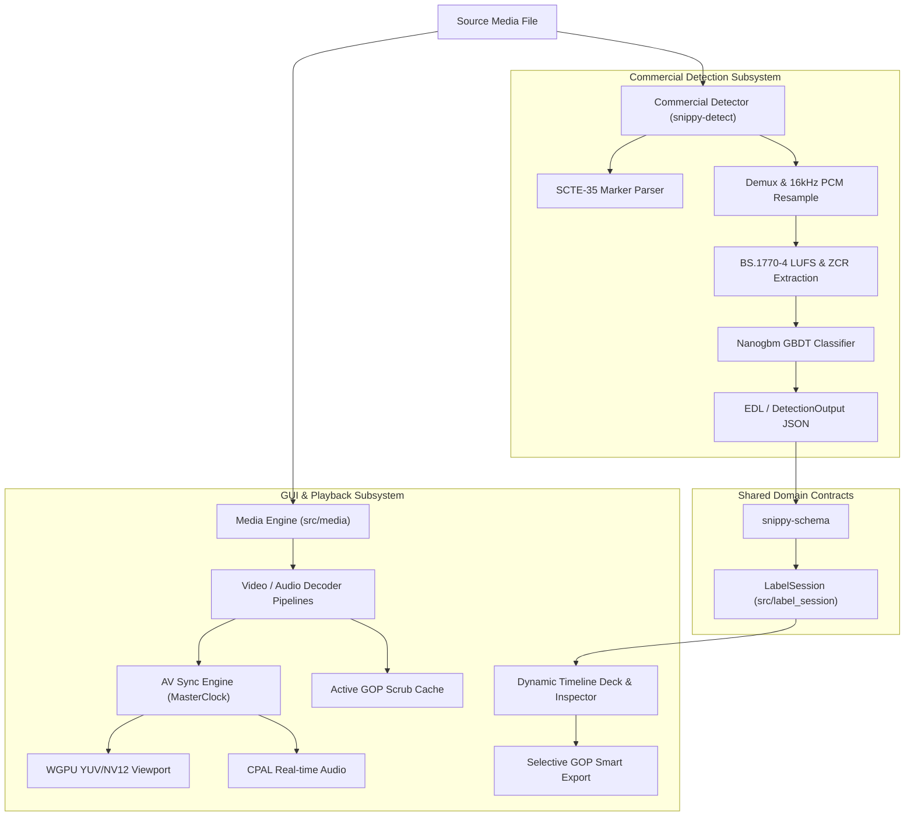

# Snippy 2 Blueprint

## System Overview
Snippy 2 is a high-performance native desktop video editor, commercial labeller, and automated commercial detection suite built with Rust, egui, WGPU, FFmpeg, and CPAL. The workspace is organized into three primary subsystems:
1. **Application & Media Engine (`src`)**: The interactive GUI video editor featuring a multi-track dynamic timeline deck, hardware-accelerated WGPU YUV video rendering, lock-free audio playback with precision AV sync, and selective GOP smart rendering.
2. **Commercial Detection Suite (`snippy-detect`)**: An automated commercial detection engine and CLI pipeline utilizing SCTE-35 cue detection, ITU-R BS.1770-4 loudness profiling, zero crossing rate extraction, and GBDT machine learning classification.
3. **Shared Schemas (`snippy-schema`)**: Unified domain contracts defining ground-truth recording annotations, transition boundaries, and detection output envelopes exchanged between the GUI labeller and detection services.

## Subdirectories & System Boundaries
- `snippy-detect`: [./snippy-detect/README.md](./snippy-detect/README.md) - Automated TV commercial detection engine, SCTE-35 cue parser, BS.1770 LUFS/ZCR feature extractor, GBDT/ONNX classifiers, and model training utilities
- `snippy-schema`: [./snippy-schema/README.md](./snippy-schema/README.md) - Shared serialization models and domain contracts for ground truth break annotations and commercial detection envelopes
- `src`: [./src/README.md](./src/README.md) - Desktop GUI editor application, multi-threaded FFmpeg media engine, CPAL audio playback, dynamic timeline deck, and WGPU renderer

## Global Invariants
- `[Cargo.toml:workspace]` - Multi-crate workspace binding root package (`snippy2`), detection engine (`snippy-detect`), and shared models (`snippy-schema`) under Rust edition 2024
- `[snippy-schema]` - Canonical schema version (`1`) and 90 kHz timebase (`"1/90000"`) shared between `src` (labelling UI) and `snippy-detect` (detection CLI and training tools)
- `[src/media/export.rs]` - Lossless smart rendering preserves stream parameters by stream-copying untouched GOPs and only re-encoding cut boundary GOPs with x264
- `[src/audio/clock.rs & src/media/sync.rs]` - AV synchronization is strictly governed by `MasterClock` presentation timestamps (PTS) derived from audio sample counts, falling back to monotonic wall clock when audio is absent

## Global Side Effects
- **File I/O**: Reads input video files via FFmpeg demuxing; writes ground-truth annotations (`<video>.ground-truth.json`), detection cutlists (`.edl`, `.json`), GBDT models (`resources/models/classifier.json`), user settings (`~/.config/snippy/settings.toml`), and exported MP4 files
- **Hardware Acceleration**: Probes and acquires GPU devices and textures via WGPU (graphics) and FFmpeg hardware acceleration APIs (VAAPI, VideoToolbox, D3D11)
- **Audio Device**: Acquires real-time default OS audio playback device streams via CPAL

## System Verification
- Run: `cargo test`
