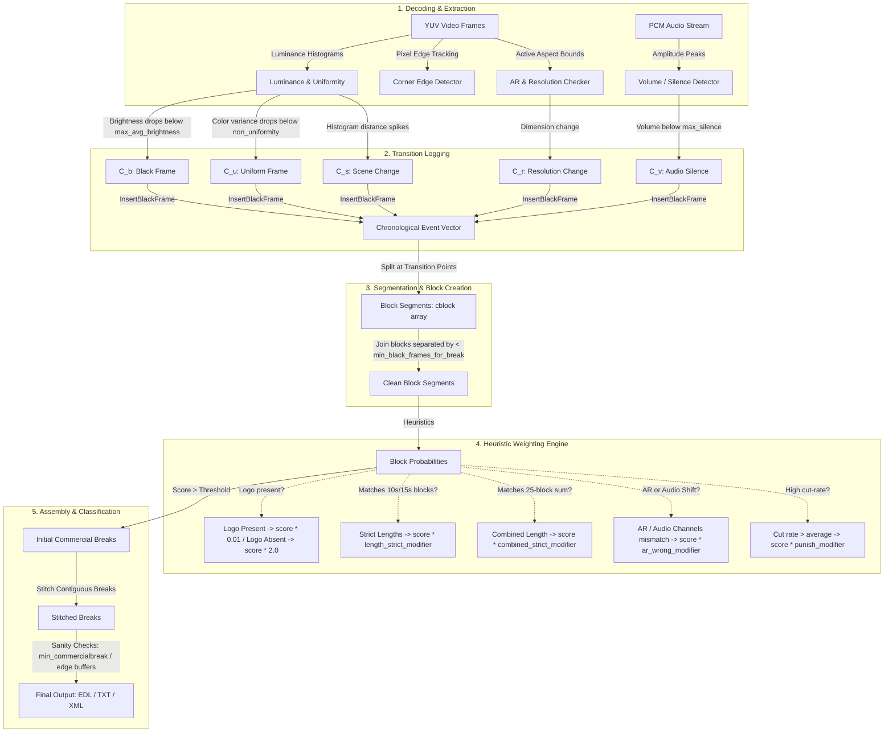

# Comskip Commercial Detection Algorithm Analysis

This document provides a detailed evaluation of the commercial detection methods used by [comskip](file:///Users/dselck/Documents/Inspiration/Comskip/) and outlines concrete strategies to improve upon them for a modern, native **Rust** implementation.

---

## 1. Refined Matching & Detection Pipeline

The following diagram illustrates the exact flow of metrics, data transformations, and classification layers required to match the behavior of comskip:

---

## 2. In-Depth Method Analysis & Critiques

Below is an analysis of each primary detection vector, detailing how comskip implements it and where the limitations lie.

| Detection Vector | Comskip Implementation Method | Core Bottlenecks & Limitations |
| :--- | :--- | :--- |
| **Black / Uniform Frames** | Computes average luminance and checks if uniform pixels exceed threshold. Logs as `C_b` (black) or `C_u` (uniform color). | Highly sensitive to noise in analog/low-bitrate captures. Fade-to-black transitions with gradients can completely miss thresholds. |
| **Scene Changes** | Compares absolute differences in pixel bin counts between successive histograms (`schange_percent`). | Misses slow dissolves, wipes, or color-graded transitions. Easily fooled by fast motion or flashlights. |
| **Audio Silence** | Monitors absolute peak amplitude of PCM samples within a narrow time frame. | Susceptible to low-level analog hiss, background hum, or continuous tone frequencies. |
| **Aspect Ratio (AR)** | Scans black margins (letterbox/pillarbox) to find active drawing areas. | Fails on complex letterboxing (e.g. varying dynamic aspect ratios in movies) or if station tickers bleed into margins. |
| **Station Logo Tracking** | Accumulates binary edge maps across frames over time. Evaluates logo presence per block. | Dynamic/animated logos, translucent bugs, ticker crawls, or colored banners degrade edge detection accuracy. |
| **Block Combinatorics** | Brute-force evaluates combinations of contiguous blocks to match standard ad slot multiples (e.g. 30s, 60s). | Combinatorial explosion. Relies heavily on exact block boundaries; a single missed scene transition breaks the combination logic. |

---

## 3. Opportunities for Improvement: Building a Better System

Your native Rust implementation has the opportunity to bypass these legacy bottlenecks by employing modern signal processing, computer vision, and machine learning techniques.

### Improvement 1: Machine Learning (ML) Classification instead of Manual Heuristics
* **The Problem**: Comskip relies on hand-tuned multipliers (e.g., `cblock[i].score *= logo_present_modifier`). Tuning these parameters is notoriously difficult and highly fragile when moving between channels, countries, or video formats.
* **The Solution**: Use a lightweight machine learning model (e.g. a Gradient Boosted Decision Tree using `linfa` or a pre-trained ONNX model via `ort`).
  * **Features**: Frame rate, block duration, average loudness delta, logo presence ratio, AR mismatch flag, scene change density.
  * **Benefit**: The model outputs a clean probability vector for each block, making classification self-tuning, robust, and significantly more accurate.

### Improvement 2: Upgrading Audio Analysis to EBU R128 (LUFS) Loudness
* **The Problem**: Comskip's raw amplitude peak thresholding cannot differentiate between perceptually loud segments (like commercials) and dynamic show audio.
* **The Solution**: Implement **LUFS (Loudness Units relative to Full Scale)** tracking (matching EBU R128 standards). 
  * Commercials are dynamically compressed to sound as loud as possible within broadcast limits. Tracking LUFS and spectral density (commercials tend to have a flatter, denser audio spectrum) makes audio transitions highly visible.
  * We can construct a rolling short-term LUFS vector to identify the classic compression jump associated with commercial breaks.

### Improvement 3: Structural Similarity (SSIM) for Logo Tracking
* **The Problem**: Comskip's binary edge map accumulation frequently breaks due to video compression noise or dynamic backgrounds behind translucent logos.
* **The Solution**: Implement structural similarity metrics (SSIM). By computing temporal variance maps of structural features in the corner quadrants, we can locate static overlays even if they are translucent or dynamic. 

### Improvement 4: Transition Point Synchronization via Audio Envelope Cross-correlation
* **The Problem**: A fade-to-black may be misaligned with the audio cut by 15-30 frames, resulting in abrupt audio cuts or show bleeding when trimming.
* **The Solution**: Sync cut points by looking at the cross-correlation of the audio envelope decay and scene change metrics. Placing cuts exactly at the sub-second moment of audio energy minima ensures smooth, professional-grade cuts.

### Improvement 5: Outlier Cluster Classification using Visual Embeddings
* **The Problem**: Shows are visually cohesive (set designs, color palettes, lighting setups remain consistent), whereas commercials are visual outliers with highly varied color palettes and fast cut rates.
* **The Solution**: Feed low-resolution frame features into a clustering pipeline.
  * Downsample keyframes to a tiny color grid (e.g., $8 \times 8$ average color grid).
  * Compute structural distance vectors. Shows will naturally cluster together, whereas commercial blocks will sit as distinct, rapid-firing clusters outside the show distribution.
