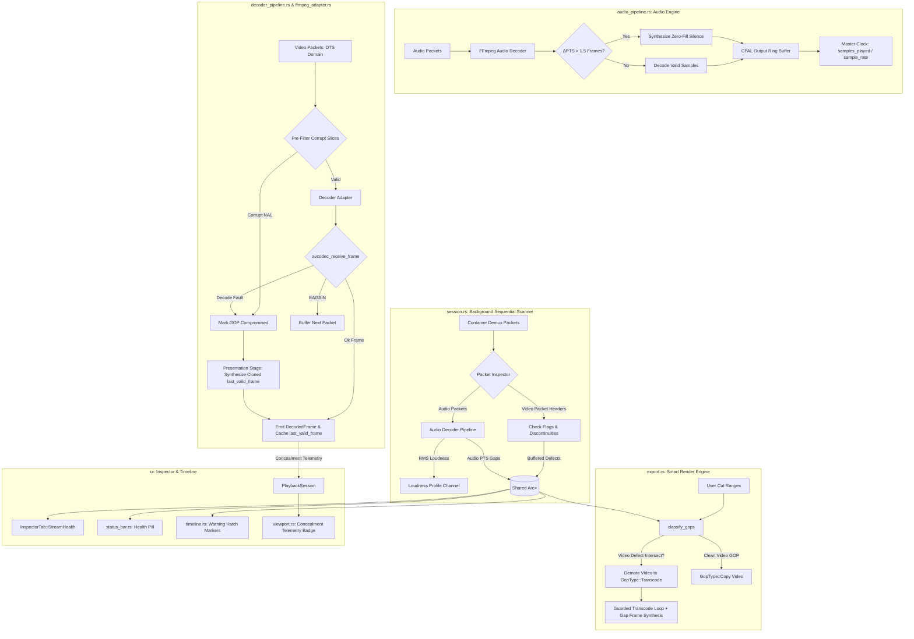

# Media Fault Tolerance: In-Memory Healing & Stream Health Pipeline

* **Author:** David Selck
* **Status:** Draft
* **Date:** 2026-11-10

---

## Overview

Broadcast television recordings (e.g., ATSC, DVB, cable captures) frequently contain missing packets, transmission dropouts, and multiplexer timing irregularities. In Snippy, these issues break three fundamental operational assumptions:
1. **Audio Master Clock Lock:** Because the playback master clock relies on cumulative hardware audio samples (`current_time = samples_played / sample_rate`), missing audio packets cause sample emission to stop while container time advances. This induces timeline desynchronization and video presentation stalls.
2. **Decoder State Stability:** Hardware and software video decoders fed corrupted or missing reference slices produce macroblock smearing, enter unrecoverable error states, or trigger GPU context crashes.
3. **Smart Render Integrity:** Snippy's fast-export engine copies fully kept Groups of Pictures (GOPs) directly without re-encoding (`GopType::Copy`). Stream-copying corrupted broadcast packets injects non-monotonic timestamps and malformed bitstreams into exported files.

This design establishes an end-to-end fault tolerance and in-memory healing architecture. It detects defects via a unified background demux pass, maintains continuous presentation time via audio silence synthesis and video freeze-frame concealment, demotes damaged video GOPs to re-encoding during export, and exposes stream health metrics through a dedicated Inspector HUD and status bar indicator.

---

## Problem Statement

Snippy is engineered for high-performance trimming and snippet extraction from native video files. However, broadcast captures frequently exhibit transmission defects:
* **Signal Loss & Packet Dropouts:** Over-the-air signal fluctuations and satellite rain fade cause bursts of missing transport packets (MPEG-TS Continuity Counter errors, PES header truncation).
* **Clock Drift During Playback:** Dropped audio frames cause the audio callback to fall behind container Presentation Timestamps (PTS). When video timestamps advance ahead of the audio clock, the video synchronizer stalls presentation waiting for audio to catch up.
* **Cascading Visual Corruption:** When an I-frame or P-frame reference slice is corrupted, subsequent P- and B-frames in the GOP compute motion vectors against corrupted memory, creating macroblock decode artifacts and smearing across the remainder of the GOP.
* **Corrupt Export Bitstreams:** Attempting to Smart Render a broadcast file with direct packet copying propagates invalid bitstream data into standard MP4/MKV containers, resulting in playback errors or crashes in downstream media players.
* **Operator Uncertainty:** Without visual status indicators during freeze-frame holds, operators cannot distinguish stream concealment from application thread deadlocks.

---

## Goals & Non-Goals

### Goals

* **G1: A/V Sync Invariant:** Prevent Master Clock drift when audio packets are lost or corrupted. Maintain timeline presentation alignment with cumulative A/V phase error bounded within $\pm 1$ audio sample period.
* **G2: Macroblock Smear Suppression:** Suppress corrupted video reference frames from propagating visual distortion through the remainder of a GOP during interactive playback and scrubbing.
* **G3: Zero Extra I/O Defect Discovery:** Identify and map container-level packet discontinuities and corruption flags across the media file by extending the background demux loudness pass, without launching a separate disk-reading thread or running full-file video decoding.
* **G4: Export Bitstream Hygiene:** Ensure that no corrupted packet or non-monotonic timestamp is copied to an exported output file. Demote any GOP intersecting a video defect to `GopType::Transcode`.
* **G5: Non-Destructive Source Protection:** Maintain source media immutability. All repairs occur dynamically in-memory during playback or through sanitized transcoding during export.
* **G6: Stream Health Visibility:** Expose defect counts, affected durations, and contiguous error intervals via an integrated `InspectorTab::StreamHealth` HUD, timeline warning markers, and a status bar health indicator.

### Non-Goals

* **NG1: Generative / Neural Video Inpainting:** We will not integrate deep learning models (e.g. RIFE, FILM, ProPainter) or optical-flow motion interpolation. These models require large runtime dependencies (>100MB model binaries), incur high inference latency incompatible with real-time 60fps playback, and introduce interpolation artifacts across scene cuts.
* **NG2: In-Place Source File Rewriting:** We will not modify, patch, or overwrite the user's original recording on disk.
* **NG3: Exhaustive Background Video Pixel Decoding:** We will not decode every video frame at import time to check for deep intra-macroblock syntax errors. Scanning is constrained to container packet headers and audio decode passes to keep disk and CPU usage lightweight.
* **NG4: Intrusive Error Dialogs:** We will not display modal alerts, popup dialogs, or workflow-interrupting banners for corrupted stream packets.

---

## Critical User Journeys (CUJs)

### CUJ 1: Playback of Broadcast Capture with Audio Dropouts
* **Given**: A user opens an MPEG-TS television capture containing a 500ms audio packet dropout caused by antenna signal fade.
* **When**: The user presses play and playback reaches the dropout region.
* **Then**: The audio pipeline synthesizes silent PCM samples across the 500ms gap. The Master Clock advances monotonically, video frames present without stuttering or falling out of sync, and playback continues uninterrupted.

### CUJ 2: Scrubbing and Concealing Corrupted Video GOPs
* **Given**: A broadcast capture has a damaged keyframe packet in GOP #14 (frames 420–450).
* **When**: The user scrubs through frames 420 to 450.
* **Then**: The video decoder detects the corrupted packet, marks the GOP as compromised, and suppresses corrupted P/B slices. The viewport holds frame 419 (with a semi-transparent HUD overlay badge `[CONCEALED: HOLDING FRAME #419]`) until clean keyframe 451 arrives, avoiding macroblock smearing.

### CUJ 3: Safe Smart Render of Damaged Content
* **Given**: The user defines an export range covering GOPs #10 through #20, where GOP #14 contains corrupted video slices.
* **When**: The user initiates a Smart Render export.
* **Then**: The exporter classifies GOPs #10–13 and #15–20 as `GopType::Copy` (stream-copy), but automatically demotes GOP #14 to `GopType::Transcode`. During transcoding of GOP #14, the transcode loop feeds synthesized duplicate frames into the encoder on decode errors. The resulting MP4 export plays in external players without container errors, sync drift, or decoding crashes.

### CUJ 4: Inspecting Capture Health and Auto-Snipping Defects
* **Given**: A newly loaded recording finishes its background demux pass, discovering three separate signal dropout segments.
* **When**: The user notices the status bar indicator (`● HEALTH: 3 DEFECTS`) and clicks it.
* **Then**: The Floating Inspector HUD opens to the `StreamHealth` tab, listing the three contiguous defect ranges with timecodes and durations. The user clicks "Auto-Snip Defect Ranges", which automatically sets `app.cut_mode = true` and creates cut ranges snapped to keyframe boundaries across all three damaged intervals.

---

## Proposed Architecture

### 1. High-Level System Topology & Data Flow

The fault-tolerance pipeline integrates across background demux indexing, audio resample feeding, video decoder presentation, export GOP classification, and UI status rendering:



---

### 2. Bounded Data Structures (`src/media/types.rs`)

To ensure bounded memory usage on captures containing thousands of dropped packets, individual packet defects are coalesced into contiguous ranges using a 500ms clustering window. Incoming packets delivered in DTS order (where B-frames cause alternating PTS) are merged with bounds expansion:

```rust
#[derive(Clone, Copy, Debug, PartialEq, Eq)]
pub struct StreamTypeMask(pub u8);

impl StreamTypeMask {
    pub const AUDIO: Self = Self(0b01);
    pub const VIDEO: Self = Self(0b10);
    pub const BOTH: Self  = Self(0b11);

    pub fn contains(&self, other: Self) -> bool {
        (self.0 & other.0) == other.0
    }

    pub fn insert(&mut self, other: Self) {
        self.0 |= other.0;
    }
}

#[derive(Clone, Copy, Debug, PartialEq, Eq)]
pub enum DefectErrorType {
    TimestampDiscontinuity,
    CorruptBitstreamPayload,
    DecoderFault,
}

#[derive(Clone, Debug, PartialEq)]
pub struct ContiguousDefectRange {
    pub start_pts_sec: f64,
    pub end_pts_sec: f64,
    pub affected_streams: StreamTypeMask,
    pub error_type: DefectErrorType,
    pub packet_count: usize,
    pub affected_gop_indices: Vec<usize>,
}

#[derive(Clone, Debug, Default)]
pub struct DefectMap {
    ranges: Vec<ContiguousDefectRange>,
    total_defective_packets: usize,
    total_audio_dropout_sec: f64,
    total_video_defect_sec: f64,
}

impl DefectMap {
    pub fn new() -> Self {
        Self::default()
    }

    pub fn insert_or_coalesce(
        &mut self,
        pts_sec: f64,
        duration_sec: f64,
        stream: StreamTypeMask,
        error: DefectErrorType,
        gop_idx: Option<usize>,
    ) {
        self.total_defective_packets += 1;
        if stream.contains(StreamTypeMask::AUDIO) {
            self.total_audio_dropout_sec += duration_sec;
        }
        if stream.contains(StreamTypeMask::VIDEO) {
            self.total_video_defect_sec += duration_sec;
        }

        let end_pts_sec = pts_sec + duration_sec.max(0.001);

        // Coalesce with adjacent or overlapping range if within 500ms
        for range in self.ranges.iter_mut() {
            if pts_sec <= range.end_pts_sec + 0.500 && end_pts_sec + 0.500 >= range.start_pts_sec {
                range.start_pts_sec = range.start_pts_sec.min(pts_sec);
                range.end_pts_sec = range.end_pts_sec.max(end_pts_sec);
                range.affected_streams.insert(stream);
                range.packet_count += 1;
                if let Some(g_idx) = gop_idx {
                    if !range.affected_gop_indices.contains(&g_idx) {
                        range.affected_gop_indices.push(g_idx);
                    }
                }
                return;
            }
        }

        self.ranges.push(ContiguousDefectRange {
            start_pts_sec: pts_sec,
            end_pts_sec,
            affected_streams: stream,
            error_type: error,
            packet_count: 1,
            affected_gop_indices: gop_idx.into_iter().collect(),
        });
        self.ranges.sort_by(|a, b| a.start_pts_sec.partial_cmp(&b.start_pts_sec).unwrap());
    }

    pub fn intersects_video_gop(&self, gop_start_sec: f64, gop_end_sec: f64) -> bool {
        self.ranges.iter().any(|r| {
            r.affected_streams.contains(StreamTypeMask::VIDEO)
                && r.start_pts_sec < gop_end_sec
                && r.end_pts_sec > gop_start_sec
        })
    }

    pub fn ranges(&self) -> &[ContiguousDefectRange] {
        &self.ranges
    }

    pub fn summary(&self) -> (usize, f64, usize) {
        (
            self.ranges.len(),
            self.total_audio_dropout_sec.max(self.total_video_defect_sec),
            self.total_defective_packets,
        )
    }
}
```

---

### 3. Unified Background Demux Defect Scanner (`src/media/session.rs`)

The background demux thread (`run_background_media_scanner`, formerly `run_entire_audio_decoder`) processes packets sequentially to compute the `LoudnessProfile`. We extend this loop into a unified packet scanner without spawning an extra demuxer thread:

* **Audio-Optional Execution:** The background loop executes even if a file contains no audio stream, ensuring video packet defects are scanned on video-only media.
* **Video Packet Header Auditing:** For packets matching `video_stream_index`:
  1. Inspect `packet.flags().contains(AV_PKT_FLAG_CORRUPT)`.
  2. Track transport stream continuity discrepancies and negative/unexpected DTS jumps ($\Delta \text{DTS} > 2.0 \times \text{nominal\_frame\_interval}$).
  3. Map the packet's PTS to its containing GOP index using keyframe timestamps.
  4. Buffer detected anomalies locally and commit them in batches (every 100ms or per GOP) to `Arc<RwLock<DefectMap>>` to prevent lock contention against 60 FPS UI rendering.
* **Audio Packet Demux Auditing:** For packets matching `audio_stream_index`:
  1. During RMS loudness calculation, track container PTS continuity.
  2. If $\Delta \text{PTS} > 1.5 \times \text{nominal\_audio\_frame\_duration}$, log a `TimestampDiscontinuity` defect into `DefectMap`.

---

### 4. Audio Master Clock Lock & Silence Padding (`src/media/audio_pipeline.rs`)

To preserve the `current_time = samples_played / sample_rate` invariant without clock drift:

* **Detection Seam:** In `AudioDecoderPipeline::receive_samples()`:
  1. Record `last_emitted_pts`. When the next audio frame is decoded with `frame_pts`:
  2. Calculate $\Delta = \text{frame\_pts} - \text{last\_emitted\_pts} - \text{frame\_duration}$.
  3. **Positive Gap Padding:** If $\Delta > 1.5 \times \text{nominal\_audio\_frame\_duration}$:
     * Compute missing sample count: `missing_samples = (Δ * target_sample_rate).round() as usize`.
     * Synthesize a buffer of zeros (`0.0_f32`) of length `missing_samples * channels`.
     * Apply a linear gain ramp on the first valid incoming frame to suppress step clicks.
     * Increment `self.frames_written_total += missing_samples`.
     * Push synthetic silent samples to the CPAL ring buffer before pushing valid samples.
  4. **Negative Gap Trimming:** If $\Delta < 0.0$ (timestamp overlap from duplicate packets or container splices):
     * Trim the overlapping duration from incoming samples to prevent advancing `frames_written_total` ahead of container PTS.
* **Seek State Invalidation:** `AudioDecoderPipeline::handle_seek()` explicitly resets `self.last_emitted_pts = None` to prevent post-seek packets from comparing against pre-seek timestamps.

---

### 5. Resilient Video Decoder Architecture (`src/media/decoder_pipeline.rs`, `src/media/ffmpeg_adapter.rs`)

The video decoder pipeline implements purely reactive runtime error concealment:

#### A. Decoupled DTS Pre-Filtering vs. PTS Presentation Synthesis
* Demux packets arrive in DTS order. Pre-filtering in `VideoDecoderPipeline::process_packet` inspects corruption flags before calling `adapter.send_packet()`. Corrupted packets are discarded and the GOP is marked `is_gop_compromised = true`.
* Frame synthesis is executed strictly in the presentation stage within `process_packet`'s inner frame loop, maintaining temporal display order and preventing `VideoSyncEngine` backwards-PTS stalls.

#### B. `EAGAIN` Contract Adherence
* In `FfmpegDecoderAdapter::receive_frame`, `AVERROR(EAGAIN)` is preserved as `Ok(None)`. The pipeline treats this as normal buffering for reordered B-frames. Concealment is triggered only on true terminal errors (`DecodeError::Fault`, `AVERROR_INVALIDDATA`) or when an active `is_gop_compromised` flag suppresses damaged reference slices.

#### C. In-Decoder Freeze-Frame Concealment
* The active decoder adapter is retained throughout the GOP. Mid-GOP decoder hot-swapping is avoided because new decoders lack reference frames in their Decoded Picture Buffer (DPB).
* When `is_gop_compromised = true`:
  1. Output of subsequent damaged P/B frames in the GOP is suppressed.
  2. For each missing presentation slot, `synthesize_concealment_frame(frame_idx, pts_sec)` clones `last_valid_frame` with current timecode stamps.
  3. Synthesized frames stamp `sequence_id = self.current_sequence_id` to guarantee the presenter thread in `PresenterState::Seeking` satisfies `f.sequence_id() == *sequence_id` and unblocks seek completion.
  4. If corruption occurs at frame 0 before tuner lock (`last_valid_frame` is `None`), synthesize a solid black frame matching stream dimensions and pixel format.
  5. When the next keyframe arrives, `is_gop_compromised` resets to `false`.

#### D. Hardware Decoder Safety
* During freeze-frame concealment, packet submission is suppressed for the remainder of the compromised GOP. Because the hardware decoder is idle and not allocating new surfaces, surface pool exhaustion cannot occur.

---

### 6. Export Transcode Resilience & Smart Render Demotion (`src/media/export.rs`)

* **Standalone Classification Function:** `src/media/export.rs` exposes:
  ```rust
  pub fn classify_gops(
      metadata: &VideoMetadata,
      ranges: &[ExportRange],
      cut_mode: bool,
      defect_map: Option<&DefectMap>,
  ) -> Vec<GopType>
  ```
* **Video-Specific Demotion:** Only GOPs intersecting video defects (`DefectMap::intersects_video_gop`) are demoted from `GopType::Copy` to `GopType::Transcode`. Audio dropouts do not force 4K video re-encoding.
* **Unscanned Export Pre-Check:** If an export range extends ahead of the background scanner's progress marker, the export thread performs an accelerated packet-header check over the candidate range before finalizing classification.
* **Guarded Packet Submission & Gap Filling:** In the transcode loop, `decoder.send_packet(&packet)` errors are caught without aborting. `fill_transcode_gaps()` injects duplicate frames into `video_encoder.send_frame()` for missing frame indices, producing strictly monotonic DTS/PTS vectors.
* **Parameter Parity:** Demoted transcode encoders extract SPS/PPS, profile, level, color primaries, transfer characteristics, and matrix coefficients from the source stream to match adjacent copied GOPs.

---

### 7. Stream Health UI Architecture (`src/ui/inspector.rs`, `src/ui/status_bar.rs`, `src/ui/viewport.rs`)

* **`InspectorTab::StreamHealth`:** In [`src/ui/inspector.rs`](file:///home/dselck/Code/snippy/src/ui/inspector.rs):
  * Displays total defect count, affected duration, and defective packet count.
  * Interactive table of `ContiguousDefectRange` items showing start timecode, duration, and error type. Clicking a defect seeks the playhead directly to that timecode.
  * **"Auto-Snip Defect Ranges" Button:** Automatically sets `app.cut_mode = true` and generates cut ranges spanning detected defect intervals, snapping start and end boundaries to nearest keyframes (`KeyframeIndex`) so surrounding clean ranges stream-copy cleanly.
* **Status Bar Health Pill:** In [`src/ui/status_bar.rs`](file:///home/dselck/Code/snippy/src/ui/status_bar.rs):
  * Renders green (`● HEALTH: CLEAN`) if no defects exist, or amber (`● HEALTH: N DEFECTS (X.Xs)`) if defects are present.
  * Clicking the pill toggles `InspectorTab::StreamHealth`.
* **Thread-Safe Viewport Concealment Telemetry:** In [`src/ui/viewport.rs`](file:///home/dselck/Code/snippy/src/ui/viewport.rs):
  * Rather than querying the decoder pipeline directly across thread boundaries, `DecodedFrame` carries telemetry (`is_concealed: bool`, `held_frame_idx: Option<usize>`).
  * `PlaybackSession` records active concealment state during presentation.
  * When freeze-frame concealment is active between 1.0s and 3.0s, the viewport renders a semi-transparent HUD overlay badge: `[CONCEALED: HOLDING FRAME #N]`.
  * For dropouts exceeding 3.0s, viewport rendering transitions to solid black based on `Settings::playback.prolonged_dropout_behavior`.
* **Timeline Defect Markers:** In [`src/ui/timeline.rs`](file:///home/dselck/Code/snippy/src/ui/timeline.rs), subtle amber warning hatch markers render along the top edge of the filmstrip over defect intervals.

---

## Alternatives Considered

### Alternative A: Neural / Optical Flow Video Frame Interpolation
* **Pros**: Synthesizes intermediate video motion across missing frame gaps without visible pauses.
* **Cons**: Requires large runtime dependencies (>100MB model binaries), incurs high inference latency incompatible with real-time 60fps playback, and introduces interpolation artifacts across scene cuts and noisy broadcast dropouts.
* **Rejection Rationale**: Real-time neural frame interpolation introduces runtime bloat, severe performance penalties, and visual hallucinations across scene transitions. Freeze-frame concealment preserves temporal truth without visual artifacts.

### Alternative B: In-Place Source Media File Rewriting
* **Pros**: Permanently repairs the source recording on disk, allowing external media players to benefit from fixes.
* **Cons**: Mutating the source recording on disk violates Snippy's non-destructive editing invariant. A crash or power loss mid-rewrite causes unrecoverable source data loss and invalidates container references.
* **Rejection Rationale**: Mutating source recordings violates non-destructive editing principles and creates data loss risks. In-memory healing preserves source immutability.

### Alternative C: Intrusive Error Dialogs and Popup Banners
* **Pros**: Immediately forces user attention whenever corrupted packets are encountered during file import.
* **Cons**: Modal dialogs and dismissible notification banners create workflow interruptions when importing broadcast captures with numerous transport discontinuities.
* **Rejection Rationale**: Frequent popups disrupt user workflow. Surfacing defects through an integrated `InspectorTab::StreamHealth` panel, timeline warning markers, and a status bar pill provides actionable operational visibility without interrupting editing.

### Alternative D: Full-Decode Video Background Scan
* **Pros**: Validates every macroblock syntax element across the entire file before playback begins.
* **Cons**: Full-file video decoding saturates CPU/GPU decode blocks and disk bandwidth, causing high thermals and thread contention during interactive scrubbing.
* **Rejection Rationale**: Exhaustive video decoding causes resource starvation. Consolidating packet header validation into the existing audio loudness demux pass inspects the file at raw demux throughput (100–500x real-time) with zero additional disk reads.

### Alternative E: Dynamic Mid-GOP Decoder Swapping (HW to SW)
* **Pros**: Attempts to resume software decoding immediately when a hardware decoder encounters an error mid-stream.
* **Cons**: In inter-frame codecs (H.264/HEVC), P- and B-frames depend on reference frames held in the Decoded Picture Buffer (DPB). A newly instantiated software decoder starts with an empty DPB, triggering missing reference errors and macroblock corruption.
* **Rejection Rationale**: Swapping decoders mid-GOP fails due to empty reference buffer states. Concealing damaged GOPs within the active decoder adapter avoids multi-decoder lifecycle complexity.

### Alternative F: Timecode Truncation (Dropping Missing Time Intervals)
* **Pros**: Eliminates silent pauses and frozen video frames by deleting missing time intervals from the timeline.
* **Cons**: Truncating missing intervals breaks timecode continuity, causes sudden timeline jumps, desynchronizes multi-camera captures, and destroys alignment with external broadcast metadata and subtitle tracks.
* **Rejection Rationale**: Truncating missing time breaks timeline timecode integrity. Synthesizing audio silence and holding video frames preserves absolute container timecode alignment.

---

## Risks & Limits

### 1. Failure Modes & Recovery
* **GPU Driver Context Loss:** Corrupted hardware slice submissions can occasionally cause GPU device lost errors (`DXGI_ERROR_DEVICE_REMOVED`, `VK_ERROR_DEVICE_LOST`).  
  *Mitigation:* The packet pre-filter drops corrupted slices before hardware submission. If a driver error occurs, `VideoDecoderPipeline` captures the fault, falls back to freeze-frame hold, and marks the hardware context for reinitialization on the next keyframe.
* **CPAL Buffer Starvation / Overflow:** Extreme dropouts (>5s) could attempt to push hundreds of thousands of samples to CPAL.  
  *Mitigation:* Silence synthesis is pushed in chunked buffers sized to the CPAL ring buffer period, pacing sample emission without thread deadlocks or buffer overruns.
* **Background Demux Lag on Immediate Scrub/Export:** Users seeking to the end of a 2-hour file before the demux pass reaches it could encounter unscanned defects.  
  *Mitigation:* Playback error handling is 100% reactive and autonomous. Exporters perform a synchronous lookahead packet-header check over the target range before finalizing GOP classification.

### 2. Threat Analysis & Bitstream Security
* **Malformed Transport Streams:** Malicious or malformed broadcast streams could attempt to exploit container parser vulnerabilities in FFmpeg.  
  *Mitigation:* Snippy uses standard `libavformat` safe demuxing with validated buffer bounds. Transport packet continuity checks enforce strict arithmetic bounds checks on PTS/DTS intervals before allocating silence or concealment memory.

### 3. Operational Scale Limits
* **Extreme Packet Loss Memory Footprint:** Captures with over 50,000 discontinuous packet errors could inflate memory if logged individually.  
  *Mitigation:* The 500ms coalescing window merges adjacent defects into `ContiguousDefectRange` intervals, capping `DefectMap` memory usage to <500KB even on severely damaged captures.

---

## Non-Functional Requirements

### Performance & Latency
* **Demux Pass Speed:** The unified packet scanner must process packets at $>100\text{x}$ real-time speed, incurring $<5\%$ overhead over the baseline audio loudness demux pass.
* **Playback Overhead:** In-memory audio silence padding and video frame repetition must incur $<0.5\text{ms}$ processing overhead per frame, ensuring sustained 60fps presentation.
* **Bounded Memory Footprint:** Coalescing packet errors into contiguous ranges with a 500ms clustering window must ensure that `DefectMap` consumes $<500\text{KB}$ of RAM on files with over 100,000 corrupt packets.

### Reliability & Fault Tolerance
* **No Decoder Deadlocks:** Frame synthesis during concealment must stamp `sequence_id = self.current_sequence_id` to guarantee that the seek state machine (`PresenterState::Seeking`) satisfies `f.sequence_id() == *sequence_id` and unblocks seek completion.
* **A/V Sync Invariant:** Cumulative audio/video phase error across dropouts must remain bounded within $\pm 1$ audio sample period.
* **Export Guarantee:** Smart Render exports must produce strictly monotonic DTS/PTS vectors and re-encoded bitstreams free of container transport errors.

---

## Detailed Implementation Plan

### Phase 1: Core Data Structures & Dependencies

* **Target Files:**
  * [`Cargo.toml`](file:///home/dselck/Code/snippy/Cargo.toml) (Modify): Ensure `bitflags` dependency is present if using bitflags, or implement zero-dependency bitmask.
  * [`src/media/types.rs`](file:///home/dselck/Code/snippy/src/media/types.rs) (Modify):
    * Define `StreamTypeMask`, `DefectErrorType`, `ContiguousDefectRange`, and `DefectMap`.
    * Implement `insert_or_coalesce` with out-of-order PTS bounds expansion.
    * Implement `intersects_video_gop` checking `affected_streams.contains(StreamTypeMask::VIDEO)`.
    * Extend `DecodedFrame` with telemetry metadata: `is_concealed: bool`, `held_frame_idx: Option<usize>`.
  * [`src/settings.rs`](file:///home/dselck/Code/snippy/src/settings.rs) (Modify):
    * Add `prolonged_dropout_behavior: ProlongedDropoutBehavior` (enum: `CutToBlack`, `HoldFrame`; default `CutToBlack`) and `show_concealment_badges: bool` (default `true`) to `PlaybackSettings`.
    * Add `show_timeline_defect_markers: bool` (default `true`) to `TimelineSettings`.
* **Checkpoint:** `cargo check --lib` compiles cleanly.

---

### Phase 2: Background Media Scanner & Audio Silence Padding

* **Target Files:**
  * [`src/media/session.rs`](file:///home/dselck/Code/snippy/src/media/session.rs) (Modify):
    * Instantiate `Arc<RwLock<DefectMap>>` in `PlaybackSession` and expose `defect_map()` accessor.
    * Refactor `run_entire_audio_decoder` into `run_background_media_scanner`.
    * Permit demux loop execution when only a video stream is present, skipping only audio RMS bucket computation.
    * Track video packet `AV_PKT_FLAG_CORRUPT` and DTS continuity jumps ($\Delta \text{DTS} > 2.0 \times \text{frame\_interval}$). Buffer defect insertions and commit in batches to `DefectMap`.
    * Track audio PTS gaps ($\Delta \text{PTS} > 1.5 \times \text{nominal\_audio\_frame\_duration}$) during RMS decode and log `TimestampDiscontinuity`.
  * [`src/media/audio_pipeline.rs`](file:///home/dselck/Code/snippy/src/media/audio_pipeline.rs) (Modify):
    * Add `last_emitted_pts: Option<f64>` to `AudioDecoderPipeline`.
    * In `receive_samples()`, calculate $\Delta = \text{frame\_pts} - \text{last\_emitted\_pts} - \text{frame\_duration}$.
    * When $\Delta > 1.5 \times \text{nominal\_audio\_frame\_duration}$, generate silent PCM samples (`0.0_f32`) for the gap duration, apply linear ramp on resumption, and increment `frames_written_total += missing_samples`.
    * When $\Delta < 0.0$, trim overlapping samples to prevent advancing `frames_written_total` ahead of container PTS.
    * In `handle_seek()`, explicitly reset `last_emitted_pts = None`.
* **Checkpoint:** `cargo test media::audio_pipeline` passes with zero failures.

---

### Phase 3: Resilient Video Decoder Concealment & Telemetry

* **Target Files:**
  * [`src/media/decoder_pipeline.rs`](file:///home/dselck/Code/snippy/src/media/decoder_pipeline.rs) (Modify):
    * Add `is_gop_compromised: bool`, `last_valid_frame: Option<DecodedFrame>`, `fps: f64`, and `time_base_f64: f64` to `VideoDecoderPipeline`.
    * In `process_packet()`, inspect `AV_PKT_FLAG_CORRUPT`; discard corrupt packets and set `is_gop_compromised = true`.
    * In the inner frame-drain loop within `process_packet()`, if `is_gop_compromised` is active or a decode fault occurs, suppress subsequent P/B frames and invoke `synthesize_concealment_frame(frame_idx, pts_sec)`.
    * Stamp synthesized frames with `sequence_id = self.current_sequence_id` and mark `is_concealed = true`.
    * If `last_valid_frame` is `None`, synthesize a solid black frame.
    * On keyframes, reset `is_gop_compromised = false`.
  * [`src/media/ffmpeg_adapter.rs`](file:///home/dselck/Code/snippy/src/media/ffmpeg_adapter.rs) (Modify):
    * Ensure `FfmpegDecoderAdapter::receive_frame` preserves `AVERROR(EAGAIN)` as `Ok(None)`.
    * Enable error concealment flags (`FF_EC_GUESS_MVS`, `FF_EC_DEBLOCK`, `AV_EF_COMPLIANT`) on software video decoder contexts.
  * [`src/media/mod.rs`](file:///home/dselck/Code/snippy/src/media/mod.rs) (Modify):
    * Pass `fps` and stream timebase into `VideoDecoderPipeline::new()`.
    * Route concealment telemetry from emitted `DecodedFrame` instances to `PlaybackSession`.
* **Checkpoint:** `cargo check --lib` compiles cleanly.

---

### Phase 4: Export Engine Demotion & Gap Frame Synthesis

* **Target Files:**
  * [`src/media/export.rs`](file:///home/dselck/Code/snippy/src/media/export.rs) (Modify):
    * Extract `pub fn classify_gops(metadata: &VideoMetadata, ranges: &[ExportRange], cut_mode: bool, defect_map: Option<&DefectMap>) -> Vec<GopType>`.
    * Query `defect_map.intersects_video_gop()`; demote intersecting GOPs to `GopType::Transcode`.
    * In `export_video()`, if export ranges extend beyond background scan progress, run a targeted packet-header check before classification.
    * In transcode loop, wrap `decoder.send_packet(&packet)` in an error catch block to suppress `AVERROR_INVALIDDATA` on damaged GOPs.
    * Implement `fill_transcode_gaps(expected_idx, current_idx, last_valid_frame, video_encoder)` to inject synthesized cloned frames for missing presentation indices up to the GOP boundary.
    * Configure transcode encoders with source SPS/PPS and colorimetry parameters.
  * [`src/ui/mod.rs`](file:///home/dselck/Code/snippy/src/ui/mod.rs) (Modify):
    * In `start_export_thread()`, pass `app.playback.defect_map()` to `export_video()`.
* **Checkpoint:** `cargo test media::export` passes with zero failures.

---

### Phase 5: Stream Health UI, Settings & Telemetry

* **Target Files:**
  * [`src/ui/inspector.rs`](file:///home/dselck/Code/snippy/src/ui/inspector.rs) (Modify):
    * Add `InspectorTab::StreamHealth` to `enum InspectorTab`.
    * Implement `render_stream_health_tab()` displaying defect count, total dropout duration, defective packet count, and an interactive list of contiguous defect ranges with timecodes.
    * Add click-to-seek functionality: clicking any defect range seeks the playhead directly to its start timecode.
    * Add "Auto-Snip Defect Ranges" button: forces `app.cut_mode = true` and creates cut ranges spanning detected defect intervals, snapped to nearest keyframes (`KeyframeIndex`).
  * [`src/ui/status_bar.rs`](file:///home/dselck/Code/snippy/src/ui/status_bar.rs) (Modify):
    * Add a health status pill widget: renders green (`● HEALTH: CLEAN`) if no defects exist, or amber (`● HEALTH: N DEFECTS (X.Xs)`) if defects are present.
    * Clicking the pill toggles `InspectorTab::StreamHealth`.
  * [`src/ui/viewport.rs`](file:///home/dselck/Code/snippy/src/ui/viewport.rs) (Modify):
    * Inspect concealment state exposed on `PlaybackSession`.
    * When freeze-frame concealment is active between 1.0s and 3.0s, render semi-transparent HUD overlay badge: `[CONCEALED: HOLDING FRAME #N]`.
    * When concealment exceeds 3.0s, transition viewport rendering to solid black if configured in settings.
  * [`src/ui/timeline.rs`](file:///home/dselck/Code/snippy/src/ui/timeline.rs) (Modify):
    * Read `DefectMap::ranges()` and render subtle amber warning hatch markers along the top edge of the filmstrip over defect intervals.
  * [`src/ui/modals/settings_modal.rs`](file:///home/dselck/Code/snippy/src/ui/modals/settings_modal.rs) (Modify):
    * Add UI controls for `prolonged_dropout_behavior`, `show_concealment_badges`, and `show_timeline_defect_markers`.
* **Checkpoint:** `cargo check` compiles cleanly across all UI targets.

---

### Phase 6: Integration Tests & Domain Documentation

* **Target Files:**
  * [`tests/test_defect_healing.rs`](file:///home/dselck/Code/snippy/tests/test_defect_healing.rs) (Create):
    * Unit tests for `DefectMap` 500ms range coalescing and GOP intersection queries.
    * Audio pipeline tests verifying silence synthesis and `frames_written_total` monotonic progression across synthetic PTS gaps.
    * Video decoder pipeline mock tests verifying that packet pre-filtering, macroblock suppression, and `sequence_id` stamping properly satisfy seek barriers.
    * Export tests verifying that damaged GOPs are demoted to transcode and that `fill_transcode_gaps` fills missing indices up to expected count.
  * [`CONTEXT.md`](file:///home/dselck/Code/snippy/CONTEXT.md) (Modify):
    * Register canonical domain terms: `DefectMap`, `ContiguousDefectRange`, `Compromised GOP`, `Concealment Mode`, `Silence Padding`.
* **Checkpoint:** `cargo test --test test_defect_healing` passes with zero failures.

---

## Verification Plan

### Compilation & Static Analysis
* **Build Check:** `cargo check --all-targets` and `cargo clippy --all-targets -- -D warnings` must compile with zero warnings or errors.

### Unit & Integration Tests
* **Test Command:** `cargo test --test test_defect_healing` and `cargo test` must pass with zero failures.
* **Specific Scenarios:**
  * **Audio PTS discontinuity:** Feed packets with a 1.0s PTS gap; verify output PCM buffer contains 48,000 synthetic zero samples with linear ramp resumption and monotonic `frames_written_total` progression.
  * **Video corrupted slice:** Feed truncated NAL packet; verify pipeline marks GOP compromised and emits cloned `last_valid_frame` with valid timestamps.
  * **Seek barrier unblocking:** Simulate seek to frame 435 in a compromised GOP; verify `f.sequence_id() == target_seq_id` is emitted and presenter unblocks.
  * **Export transcode resilience:** Mock transcode loop with missing frames 10–15; verify encoder receives exactly 6 synthesized duplicate frames and produces a valid container with strictly monotonic DTS/PTS vectors.

### Manual End-to-End Verification
1. Load a real broadcast MPEG-TS recording containing signal dropouts and continuity errors.
2. Verify the status bar displays `● HEALTH: N DEFECTS` upon completion of the background demux pass.
3. Open the Stream Health inspector, verify contiguous error ranges are listed, and click a defect to verify playhead seeking to the start timecode.
4. Play across an audio dropout; confirm that audio and video remain synchronized within one frame duration and playback does not stall or drop frames.
5. Perform a Smart Render export of a range containing defects; confirm that the exported MP4 decodes in external players (e.g., VLC, mpv) without bitstream warnings, A/V desynchronization, or decoding crashes.
6. Click "Auto-Snip Defect Ranges" and verify cut ranges are created matching the detected defect intervals, snapped to nearest keyframe boundaries, with `app.cut_mode` enabled.
