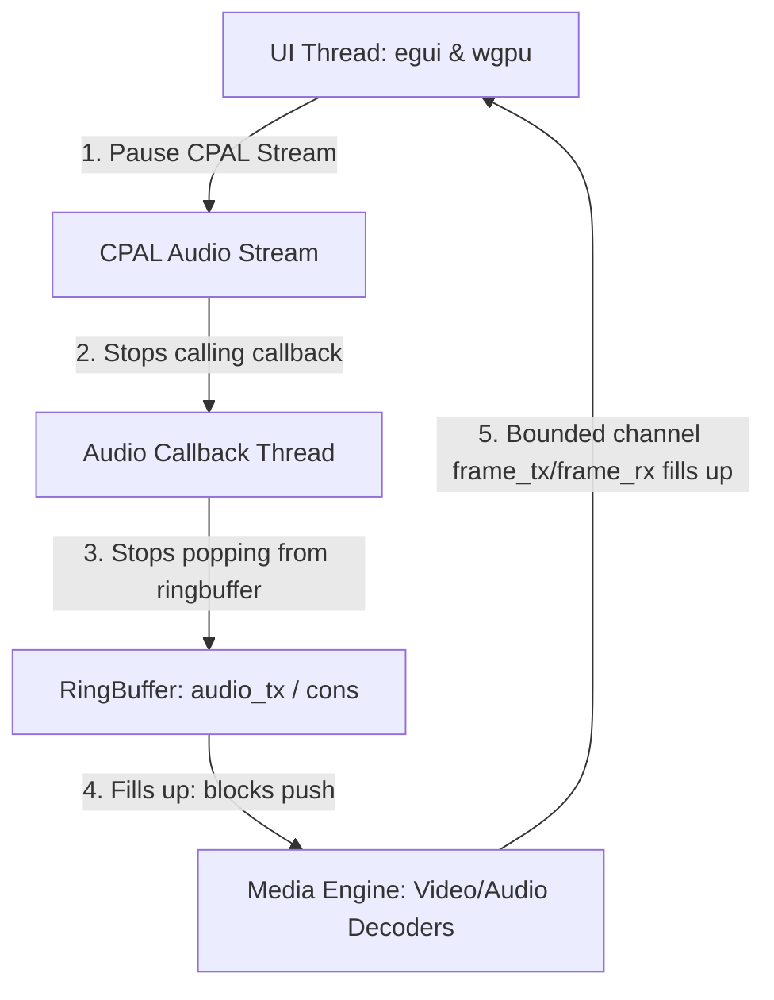

# Video Loading and Backend-Frontend Wiring Design

This design spec outlines how to connect the egui-based UI thread, the FFmpeg-based Media Engine decoding loop, and the cpal-based Audio Engine playback callback into a synchronized, backpressure-driven video editing application.

---

## 1. Concurrency & Synchronization Architecture

The application uses an "Audio-as-Master" sync model. A backpressure cascade is used to naturally pause and throttle decoding without complex cross-thread locking:



1. **Playback Control**: The UI thread controls the play/pause state by starting/pausing the `cpal::Stream` and the fallback monotonic system clock.
2. **Backpressure Cascades**:
   - When paused, CPAL stops consuming samples.
   - The audio ring buffer fills up, causing the audio decoder to block on `audio_tx.try_push`.
   - The packet queues fill up, blocking the demuxer thread.
   - The bounded `frame_tx` channel (capacity 4) fills up, blocking the video decoder.
3. **Seeking**:
   - The UI thread updates its current frame and resets the master clock.
   - It sends a `MediaCommand::Seek` to the Media Engine.
   - It drains the `frame_rx` channel to drop frames decoded before the seek.
   - The Media Engine flushes internal decoder states and performs a native file seek using the stream's true frame rate.

---

## 2. Component Design & Changes

### A. Audio Engine Control (`src/audio/mod.rs`)
- Expose the underlying `cpal::Stream` by renaming `_stream` to `stream`.
- Add public helper methods to `AudioEngine`:
  - `pub fn play(&self) -> Result<(), cpal::PlayStreamError>`
  - `pub fn pause(&self) -> Result<(), cpal::PauseStreamError>`

### B. Media Engine Seek Accuracy (`src/media/mod.rs`)
- Pass the actual video stream's `fps` (extracted from the container metadata) into the `run_decoding_loop`.
- Update the seek timestamp calculation in `run_decoding_loop`:
  ```rust
  let seek_pts = (frame_index as f64 * 1_000_000.0 / fps) as i64;
  ```

### C. UI Integration & "Load Video" Handler (`src/ui/mod.rs`)
- Add `media_engine: Option<media::MediaEngine>` to the `MainApp` struct.
- On `Load Video` button click:
  1. Trigger `rfd::FileDialog` to let the user select a video.
  2. Drop the old `media_engine` and `_audio_engine` (automatically joining background threads and closing audio output).
  3. Instantiate a new `AudioEngine` to get sample rate, channel layout, and a fresh `audio_tx` writer.
  4. Create a bounded frame channel `crossbeam_channel::bounded::<media::DecodedFrame>(4)`.
  5. Create an unbounded command channel for `MediaCommand`s.
  6. Instantiate `media::MediaEngine::new(...)` using the new video's path, `frame_tx`, `audio_tx`, and `cmd_rx`.
  7. Update metadata: `total_frames = metadata.total_frames`, `video_fps = metadata.fps`.
  8. Reset playback markers, empty ranges, set `current_frame = 0`, and reset the master clock: `playback_state.reset(0.0)`.
  9. Set `self.playback_state.has_audio` based on whether the loaded file contains an audio stream.

---

## 3. Alternative Approaches Considered
- **Command-driven thread sleeping (Approach B)**: UI sends pause/play commands to the media engine, which sleeps manually. Rejected due to high code complexity and high risk of thread race conditions/desync.
- **UI Pull-driven frame requests (Approach C)**: Decodes frames only on request. Rejected because continuous real-time audio playback requires a push model.
