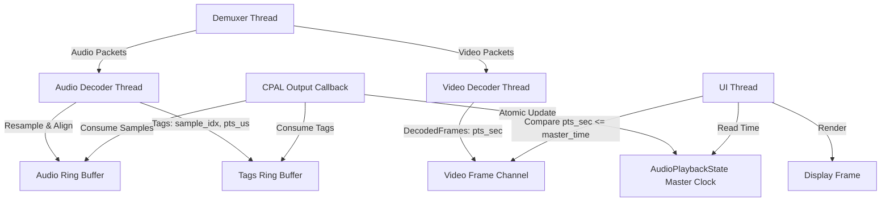

# Ground-Truth Audio-Video Precision Sync Design

This design document outlines the implementation plan to achieve sample-accurate audio-video synchronization and eliminate clock drift/stalls under all playback conditions.

## Goals
1. **Sample-Accurate Audio Alignment:** Trimming the overlapping prefix of the first audio frame after a seek, and padding small gaps (up to 150ms) with silence.
2. **Ground-Truth Video Timing:** Deciding frame promotion, discarding, and catch-up in the UI thread based on direct frame timestamp (`pts_sec`) comparisons rather than average FPS index approximations.
3. **Robust Fallback Clock:** Ensuring that when the audio engine underruns, pauses, or reaches the end of the audio stream, the master clock continues to run smoothly via the CPU fallback epoch instead of stalling.

---

## 1. Architecture

---

## 2. Component Specifications

### 2.1 Audio Thread Alignment (`src/media/mod.rs`)
The audio thread handles the first decoded audio frame after a seek:
* **Coarse Discard:** Discard frames where `pts_sec + duration_sec <= target_container_time` immediately.
* **Trim Overlap:** If the frame overlaps the seek target (`pts_sec < target_container_time`), run the resampler, calculate `discard_samples = ((target_container_time - pts_sec) * sample_rate).round()`, and slice off the prefix before writing to `audio_tx`. Push tag `(frames_written_total, skip_until_time_us)`.
* **Pad Silence:** If the frame starts after the target with a gap <= 150ms, push a tag `(frames_written_total, skip_until_time_us)` and write `pad_samples` of silence (`0.0`) before writing resampled audio data.
* **Large Gap:** If the gap is > 150ms, do not pad; push tag `(frames_written_total, pts_us)` at the actual frame timestamp.

### 2.2 CPAL Callback Stall Fix (`src/audio/mod.rs`)
The callback only updates the atomic fallback clock base (`fallback_base_us`) and start times (`fallback_start_us`) when samples are actually consumed (`written > 0`). This allows the fallback CPU clock to drive the master clock seamlessly during silence, underruns, or past the end of the audio stream.

### 2.3 UI Ground-Truth Frame Selection (`src/ui/mod.rs`)
* Frame promotion, channel receiving, and the catch-up check compare `pts_sec()` directly to `master_time` (e.g., `frame.pts_sec() <= master_time`).
* `current_frame` is updated to match the `frame_idx` of the frame currently displayed, aligning the filmstrip and progress slider directly with the screen.

---

## 3. Testing Plan
* **Integration Tests:** Verify compilation using `cargo check` and run `cargo test` / `cargo run --bin test_playback_sync` to ensure seek/sync scenarios pass.
* **Variable Frame Rate (VFR):** Verify alignment remains precise and jitter-free on variable frame rate streams.
* **EOF/Underrun Behavior:** Verify video playback continues smoothly to the end of the video even if the audio stream ends early.
