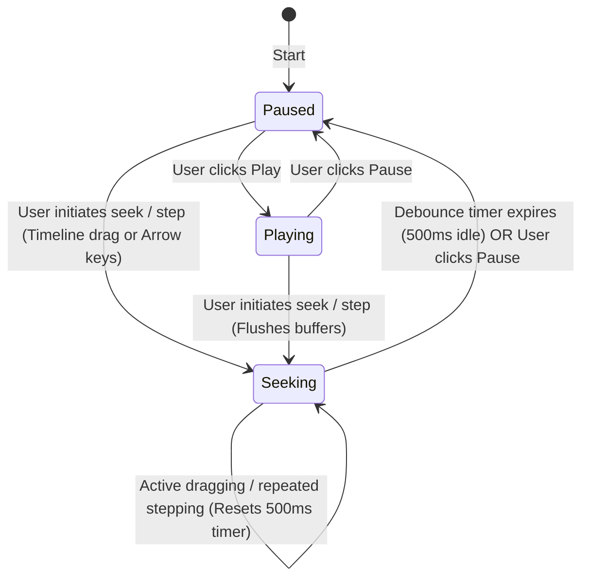

# Playback State Machine Design Spec

This document describes the design for reorganizing Snippy2's playback engine into a robust state machine. By separating seeking, paused, playing, and static states, we eliminate the post-seek fixed audio sync offset and enable buttery-smooth scrubbing and instant playback start.

---

## 1. Problem Statement
The current playback pipeline tries to synchronize audio and video *during* scrubbing and stepping. Because video decoding can be slow and seeking is asynchronous, the audio samples and their microsecond tag mappings get out of alignment. This leads to a permanent fixed audio-video sync offset after seeking, even though the telemetry claims perfect alignment.

---

## 2. Proposed State Machine

We will refactor the UI and Media Engine interaction to be driven by an explicit playback state machine containing three states: **`Seeking`**, **`Paused`**, and **`Playing`**.

### State Transition Diagram



---

## 3. State Definitions and Thread Behaviors

### A. `Seeking` State (Scrubbing & Stepping)
* **Entering**: Triggered as soon as a seek command is issued (timeline slider drag or frame-step via arrow keys).
* **Audio Behavior**: Muted. The audio decoder thread is fully idle (not decoding or sending samples). The CPAL callback writes pure silence (`0.0`) and does not read from the ring buffer.
* **Video Behavior**:
  * **Slider Drag (Timeline Scrubbing)**: Decodes and displays **keyframes only** to keep scrubbing extremely fast and light.
  * **Frame Step**: Decodes and displays the precise target frame (precise seek).
* **Buffer State**: All decoder and ring buffers are flushed and kept empty.
* **Master Clock**: Stopped and fixed at the user's target seek time.

### B. `Paused` State
* **Entering from `Seeking` (Debounced)**:
  * When the user stops seeking (no seek updates for **500 ms**), the system transitions to `Paused`.
  * **Actions**:
    1. **Precise Video Decode**: If the last seek was a keyframe-only scrub, trigger a precise (non-keyframe-only) video seek to decode and display the exact target frame.
    2. **Background Audio Priming**: Trigger a background audio seek. The audio decoder seeks to the target, decodes/resamples, discards the pre-roll, and fills the CPAL ring buffer with samples starting exactly at the current target frame. Once the buffer is full, the audio decoder halts.
* **Entering from `Playing`**:
  * Triggered when the user presses Pause.
  * **Actions**:
    * Stop the master clock.
    * The CPAL callback outputs silence, but **does not flush** the ring buffers.
    * Resuming back to `Playing` is instantaneous because the buffer remains primed.

### C. `Playing` State
* **Entering**: Triggered when the user clicks Play.
* **Actions**:
  * **Case 1: Already Primed** (entering from a settled `Paused` state): Immediately unpause the CPAL callback and start the master clock. Playback starts instantly.
  * **Case 2: Not Yet Primed** (e.g., user clicked Play within the 500ms debounce window): Immediately cancel the debounce timer, trigger the priming sequence synchronously, block/wait for the audio thread to signal readiness, then start playback.
* **Master Clock**: Active. Driven by the CPAL callback (Audio-as-Master).

---

## 4. Detailed Implementation Plan

### 1. UI State Tracking
We will add a `PlaybackState` enum to `src/ui/mod.rs` to track the state:
```rust
#[derive(Debug, Clone, Copy, PartialEq, Eq)]
pub enum PlaybackState {
    Seeking,
    Paused,
    Playing,
}
```
We will also track `last_seek_time: Option<std::time::Instant>` and `target_seek_frame: Option<usize>` in `MainApp` to manage the 500ms debounce.

### 2. Media Engine / Audio Thread Command Flow
* Introduce a way to explicitly enable/disable audio decoding:
  * Add a `set_audio_active(bool)` or similar mechanism to pause/resume the audio thread loop.
  * Alternatively, inside `AudioThreadCommand::Seek`, we can tag it with whether it is a background priming operation.
* Reduce CPAL ring buffer popping:
  * The CPAL callback in `src/audio/mod.rs` will check `playback_state.is_playing` (or a dedicated flag). If not playing, it bypasses ring buffer popping entirely and writes zeros.

### 3. Background Audio Priming
When transitioning from `Seeking` to `Paused` (after 500ms):
* Send `MediaCommand::Seek` with `keyframe_only = false`.
* The audio thread will decode up to the target position, push the tags and samples, and wait.
* The CPAL callback will receive those samples but *not* play them until the state becomes `Playing`.

---

## 5. Verification and Testing

1. **Integration Tests**: Update `src/bin/test_playback_sync.rs` to model the state transitions and assert that:
   * During the `Seeking` state, no audio samples are pushed or consumed.
   * Transitioning to `Paused` triggers the priming of the audio buffer.
   * Playback starts instantly upon entering `Playing`.
2. **Manual Verification**: Verify that scrubbing is fast, and playing after a seek starts exactly on-key and in-sync without any fixed offset.
