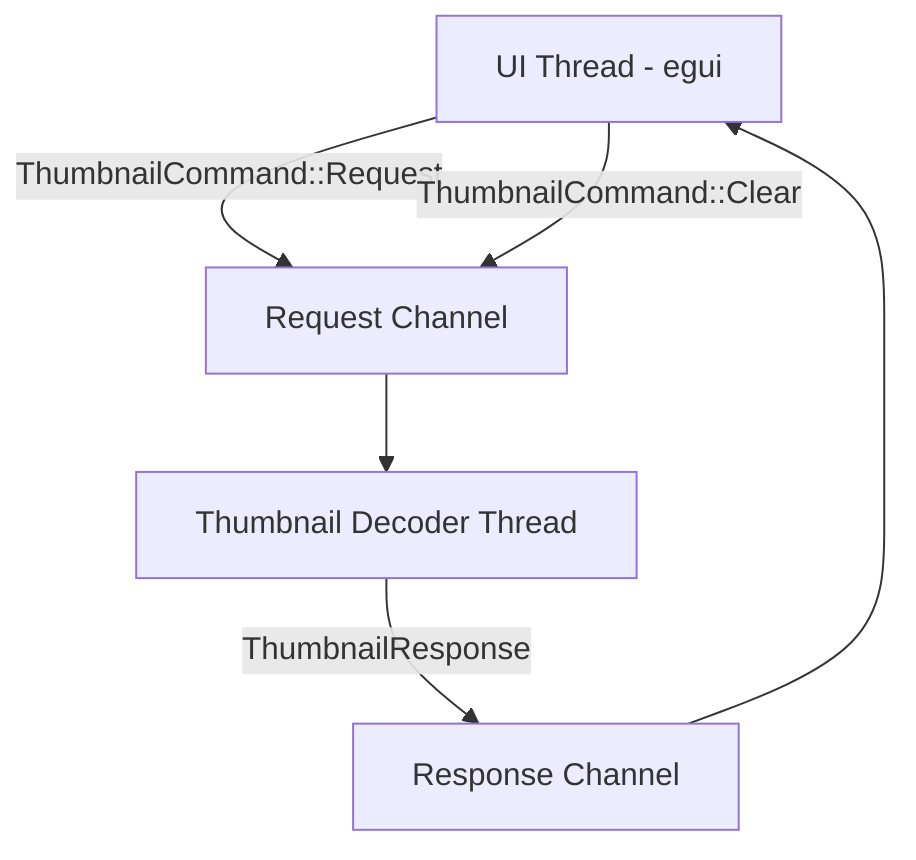

# Design Specification: Dynamic Scrolling Filmstrip and Background Thumbnail Decoder

This document specifies the design, math, architecture, and interaction model for the dynamic scrolling filmstrip and background thumbnail decoder in Snippy2.

---

## 1. Background & Objectives

The current timeline filmstrip renders static placeholder frames with solid colored blocks. The frames update as the playhead advances, causing high visual distraction and offering no visual context for the timeline.

### Objectives:
- **Scrolling Filmstrip Timeline:** Establish a fixed-position timeline where the filmstrip scrolls horizontally underneath a stationary center playhead.
- **Logarithmic Zooming:** Enable zooming from a max zoomed-out state (30 seconds between thumbnails) to a max zoomed-in state (single frames) with a logarithmic scale.
- **Background Decoding:** Decouple thumbnail extraction from the main video player and UI thread. Use a separate background thread and FFmpeg reader instance.
- **GPU Texture Caching:** Stream decoded thumbnail buffers to the UI thread, upload them as GPU textures, and cache them in an LRU or clean hashmap.
- **Aspect-Ratio Scaling:** Scale decoded thumbnails to a fixed height (72px) while preserving the video's native aspect ratio.
- **Drag-to-Scrub:** Allow dragging anywhere on the filmstrip to scrub the video smoothly.

---

## 2. Architecture & Components



### A. Communication Protocol (`src/media/thumbnails.rs`)

We define the message types for communicating with the background thumbnail decoder:

```rust
pub enum ThumbnailCommand {
    /// Open a new video file context.
    Open { path: String },
    
    /// Request a set of frame indices to decode.
    Request { frames: Vec<usize> },
    
    /// Clear the pending request queue and abort any in-flight decoding.
    Clear,
}

pub struct ThumbnailResponse {
    pub frame_idx: usize,
    pub width: u32,
    pub height: u32,
    pub rgba_data: Vec<u8>,
}
```

### B. Background `ThumbnailDecoder` Thread
A background thread dedicated to seeks and frame decoding:
- **FFmpeg Input:** Opens its own reader (`ffmpeg_next::format::context::Input`) to avoid resource contention with the main decoder.
- **State Machine:**
  - Standard loop receiving `ThumbnailCommand`s.
  - Abort check: When decoding a requested batch, it checks `channel.try_recv()` for `Clear` commands. If found, it aborts the current seek/decode cycle immediately.
  - Seeking: For a target frame index, seeks to the closest keyframe, then decodes sequentially.
  - Scaling: Converts the decoded YUV frame to RGBA and rescales it to `height = 72` (maintaining aspect ratio) using `swscale`.

### C. UI Thread Manager (`MainApp` / `src/ui/mod.rs`)
The UI thread maintains the following state:
- `thumbnail_tx: Sender<ThumbnailCommand>`
- `thumbnail_rx: Receiver<ThumbnailResponse>`
- `thumbnail_cache: HashMap<usize, egui::TextureHandle>`
- `in_flight_requests: HashSet<usize>`
- `last_zoom_level: f32`
- `last_scroll_center_sec: f32`

---

## 3. Coordinate Mappings & Spacing Math

Let:
- $W_{thumb} = \text{thumbnail\_width}$ (computed dynamically as $72.0 \times \text{aspect\_ratio}$)
- $S = \text{thumbnail\_spacing} = 6.0\text{px}$
- $W_{step} = W_{thumb} + S$ (pixel width of a single thumbnail slot)
- $Z \in [0.0, 1.0]$ be the zoom level slider position.
- $FPS$ be the video frame rate.

### A. Zoom Time Interval ($\Delta T$)
We compute the duration (in seconds) between adjacent thumbnails:
$$\Delta T = T_{max} \cdot \left(\frac{T_{min}}{T_{max}}\right)^Z$$
where:
- $T_{max} = 30.0$ seconds (max zoomed out)
- $T_{min} = \frac{1.0}{FPS}$ seconds (max zoomed in - single frame)

The scale factor in pixels per second is:
$$P_{sec} = \frac{W_{step}}{\Delta T}$$

### B. Scroll Offset Math
The playhead is stationary at the center of the filmstrip viewport:
$$X_{playhead} = \frac{\text{viewport\_width}}{2}$$

The scroll offset aligning $t = 0$ is:
$$\text{scroll\_offset\_x} = X_{playhead} - (\text{current\_playback\_time} \cdot P_{sec})$$

A thumbnail representing the interval index $k \ge 0$ is drawn at:
$$X_k = k \cdot W_{step} + \text{scroll\_offset\_x}$$

---

## 4. UI Rendering & Interaction Flow

### A. Visible Frame Range & Request Logic
During each `App::ui` update:
1. Retrieve any pending `ThumbnailResponse` messages from `thumbnail_rx`. Upload them to GPU textures using `ctx.load_texture` and insert them into `thumbnail_cache`. Remove their indices from `in_flight_requests`.
2. Compute the range of visible step indices $k$:
   $$k_{start} = \max\left(0, \left\lfloor \frac{-\text{scroll\_offset\_x}}{W_{step}} \right\rfloor\right)$$
   $$k_{end} = \left\lceil \frac{\text{viewport\_width} - \text{scroll\_offset\_x}}{W_{step}} \right\rceil$$
3. For each $k \in [k_{start}, k_{end}]$:
   - Target frame index: $F_k = \text{round}(k \cdot \Delta T \cdot FPS)$.
   - If $F_k > \text{total\_frames}$, skip.
   - If $F_k$ is not in `thumbnail_cache` and not in `in_flight_requests`:
     - Add $F_k$ to the request batch.
     - Add $F_k$ to `in_flight_requests`.
4. If a zoom change or large scrub step occurs:
   - Send `ThumbnailCommand::Clear`.
   - Clear `in_flight_requests`.
   - Send `ThumbnailCommand::Request` containing the new visible batch.

### B. Drag-to-Scrub Interaction
- Detect `mousedown` and `drag` events on the filmstrip viewport.
- Let $X_{mouse}$ be the mouse horizontal coordinate.
- Calculate the target seek time:
  $$T_{seek} = \text{current\_playback\_time} + \frac{X_{mouse} - X_{playhead}}{P_{sec}}$$
- Clamp $T_{seek} \in [0.0, \text{duration}]$ and seek to the target frame index.

---

## 5. Testing & Verification Plan

- **Unit Tests:**
  - Verify logarithmic zoom interpolation maths.
  - Verify index conversion from $X \to t \to \text{frame\_idx}$.
  - Verify queue clearing and preemption logic in the background thread.
- **Integration Tests:**
  - Simulate viewport scrolling and check that requests are correctly generated for the visible window.
  - Verify that when a file is closed/swapped, all texture handles in the cache are dropped, freeing GPU memory.
