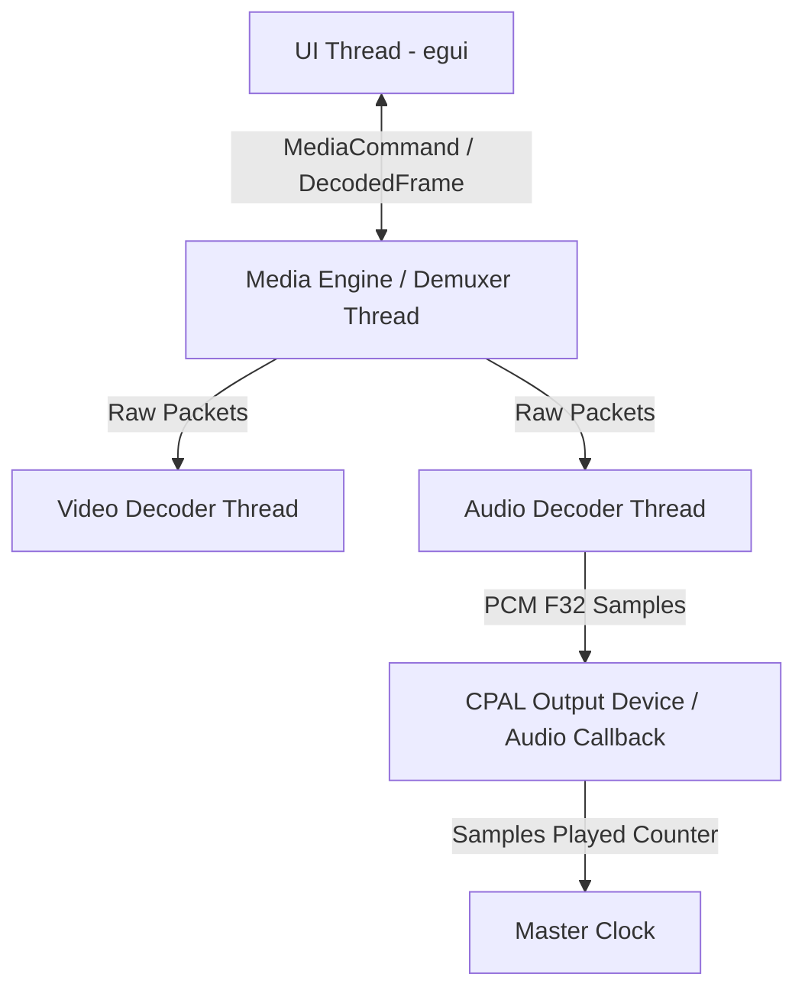
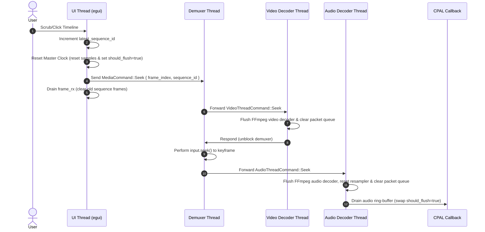

# Audio-Video Playback and Seek Synchronization

This document explains the synchronization model, threading architecture, and step-by-step lifecycle of seeking and playback synchronization in Snippy2.

---

## 1. System Architecture and Thread Roles

Playback synchronization is based on an **Audio-as-Master** clock model. The system relies on three separate background threads and the main UI thread:

### 1. Master Clock (`AudioPlaybackState`)
* **Location:** `src/audio/mod.rs` (struct `AudioPlaybackState`)
* **Role:** Serves as the single source of truth for the playback time.
* **Mechanism:**
  * **With Audio:** Calculated from the total number of audio samples successfully written to the output device: `current_time = samples_played / sample_rate`.
  * **Without Audio (Fallback):** If the file has no audio stream, or if the audio device is inactive, it uses a system monotonic timer: `current_time = fallback_base_time + fallback_start_time.elapsed()`.

### 2. Media Engine / Demuxer Thread (`run_decoding_loop`)
* **Location:** `src/media/mod.rs`
* **Role:** Parses the media container file and distributes raw packets to the video and audio decoding threads.
* **Responsibilities:**
  * Coordinates seeks by flushing context pipelines and calling FFmpeg's `input.seek()`.
  * Controls backpressure by pausing/blocking packet demuxing when downstream queues are full.

### 3. Video Decoder Thread
* **Location:** `src/media/mod.rs`
* **Role:** Consumes raw video packets, decodes them to raw frames, handles YUV format scaling via `swscale`, and sends them to the UI thread.
* **Responsibilities:**
  * Calculates frame index: `frame_idx = (pts_sec * fps).round()`.
  * Performs keyframe-only decoding (decodes only the seek target keyframe and stops) or precise sequential decoding (decodes all frames from the keyframe to the seek target).

### 4. Audio Decoder Thread
* **Location:** `src/media/mod.rs`
* **Role:** Consumes raw audio packets, decodes them, resamples them to float (`F32`) format matching the hardware device sample rate via `libswresample`, and pushes them into the CPAL ring buffer.
* **Responsibilities:**
  * Discards pre-roll audio frames decoded between the keyframe seek point and the target seek time.

### 5. UI Thread (`MainApp::update`)
* **Location:** `src/ui/mod.rs`
* **Role:** Drives the GUI layout, consumes decoded frames from the channel, and displays the correct frame matching the master clock.

---

## 2. Step-by-Step Seek Lifecycle

When a user initiates a seek (e.g. by scrubbing the timeline slider, clicking on a frame, or pressing play/pause), the following coordinated sequence occurs:

### 1. UI Thread Action
* The UI thread calls `seek_to_frame(frame_index, keyframe_only)`:
  1. **Sequence Update:** Increments `self.latest_sequence_id`. Any frame arriving later with an older sequence ID will be ignored.
  2. **Clock Reset:** Calls `self.playback_state.reset(seek_time)`. This:
     * Sets `samples_played` to `seek_time * sample_rate`.
     * Sets `fallback_base_time` to `seek_time`.
     * Sets `fallback_start_time` to `Instant::now()` if running.
     * Sets `should_flush` to `true` (an atomic flag checked by the CPAL callback).
  3. **Command Send:** Sends `MediaCommand::Seek` with the target `frame_index`, `keyframe_only` mode, and the new `sequence_id` to the demuxer thread.
  4. **Queue Clear:** Drains the `frame_rx` channel immediately to remove in-flight decoded frames from the previous sequence.
  5. **State Reset:** Sets `self.future_frame = None`.

### 2. Demuxer Thread Action
* The demuxer thread intercepts the `Seek` command:
  1. Sends a `VideoThreadCommand::Seek` to the Video Decoder Thread.
  2. Blocks waiting for the video thread to complete its internal flush and respond.
  3. Drops the packet iterator (`packets_iter`) to release its borrow on the FFmpeg input container.
  4. Calculates the container timestamp in microseconds: `seek_pts = (video_start_time + frame_index / fps) * 1,000,000`.
  5. Calls `input.seek(seek_pts, ..seek_pts + 1)`, which positions the file pointer at the nearest keyframe at or before the seek point.
  6. Sends an `AudioThreadCommand::Seek` to the Audio Decoder Thread.
  7. Re-initializes the packet iterator (`packets_iter = input.packets()`).
  8. Resets `pending_packet = None` and resumes packet demuxing.

### 3. Video Thread Action
* The video thread receives the seek command:
  1. Sets `fallback_frame_idx = frame_index`.
  2. Sets `keyframe_only_mode = keyframe_only`.
  3. Sets `current_sequence_id = sequence_id`.
  4. Drains `video_packet_rx` to discard packets from before the seek.
  5. Flushes the FFmpeg video decoder via `video_decoder.flush()` so that it doesn't carry forward internal inter-frame dependencies from the old position.
  6. Sends `false` back to the demuxer thread to signal that flushing is complete.

### 4. Audio Thread Action
* The audio thread receives the seek command:
  1. Drains `audio_packet_rx` to discard packets from before the seek.
  2. Flushes the FFmpeg audio decoder via `audio_decoder.flush()`.
  3. Resets the resampler state (`resampler = None`) to clear internal filter delays.
  4. Sets `skip_until_time = target_time` (the seek target time relative to `video_start_time`).
  5. Sets `is_first_audio_frame = true`.
  6. Stores `true` in `playback_state.should_flush` (ensures that even if CPAL is in the middle of a callback, it drops any remaining samples).

---

## 3. Catch-Up and Frame Alignment Lifecycle

Once the seek is completed on all threads, the demuxer resumes reading packets. Because FFmpeg seeks to the nearest *keyframe*, the demuxed packets begin at a time prior to the actual target seek time. The system handles this pre-roll phase to align the audio and video.

### 1. Audio Thread Pre-roll and Clock Alignment
1. The demuxer sends audio packets starting at the keyframe to the audio thread.
2. The audio thread decodes the first frame and calculates its timestamp: `pts_sec = frame.pts * time_base`.
3. **Pre-roll Discard:** Since `is_first_audio_frame` is `true`, it compares `pts_sec` against the target time (`video_start_time + skip_until_time`).
   * If `pts_sec < target_container_time`, the entire audio frame is discarded.
   * This continues until a frame is decoded where `pts_sec >= target_container_time`.
4. **Clock Correction:** For this first valid frame, the audio thread aligns the Master Clock exactly to where the audio data starts:
   * `stream_time = pts_sec - video_start_time`.
   * Sets `samples_played = stream_time * sample_rate`.
   * Sets `is_first_audio_frame = false`.
5. Subsequent audio frames are resampled and pushed into the CPAL ring buffer (`audio_tx`).

### 2. Video Thread Pre-roll
1. The demuxer sends video packets starting at the keyframe to the video thread.
2. The video thread decodes video frames:
   * **Keyframe-only Mode (Timeline scrubbing):**
     * The video thread decodes only the first frame (the keyframe).
     * It sends this frame to the UI thread with the new `sequence_id`.
     * It sets `decode_more = false` and pauses decoding. This prevents unnecessary CPU usage and frame delivery during scrubbing.
   * **Precise Mode (Frame-stepping/Playback):**
     * The video thread decodes all frames sequentially (e.g. frames 80 to 100).
     * Each frame is sent to the UI thread via `frame_tx` with the current `sequence_id`.

### 3. UI Thread Frame Processing
1. In the update loop, the UI thread reads incoming frames from `frame_rx`:
   * **Discard Stale Frames:** If `frame.sequence_id < self.latest_sequence_id`, it is discarded immediately.
   * **Discard Pre-roll / Catch-up:**
     * The UI thread calculates the current target frame index: `target_frame = (playback_state.current_time() * video_fps) as usize`.
     * If `frame.frame_idx() <= target_frame`, it updates `self.latest_frame = Some(frame)`.
     * In precise seek mode, the video thread sends frames 80, 81, ..., 100 in rapid succession. The UI thread reads them all in a single frame update loop, rapidly updating `latest_frame` until it reaches 100.
     * If a frame arrives where `frame.frame_idx() > target_frame`, the UI thread stores it in `self.future_frame` and breaks the read loop, waiting for the master clock to advance.
